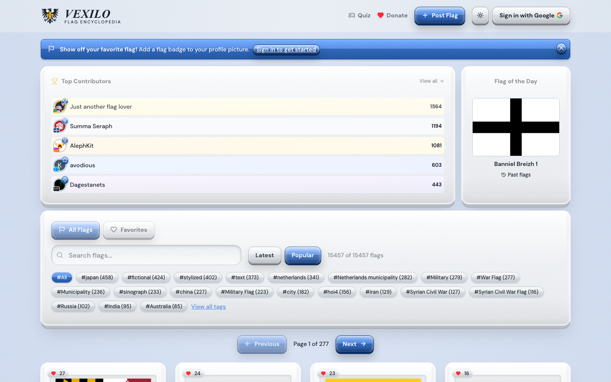
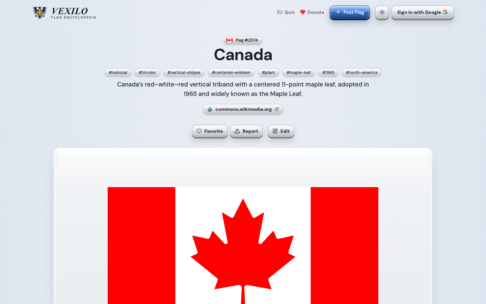
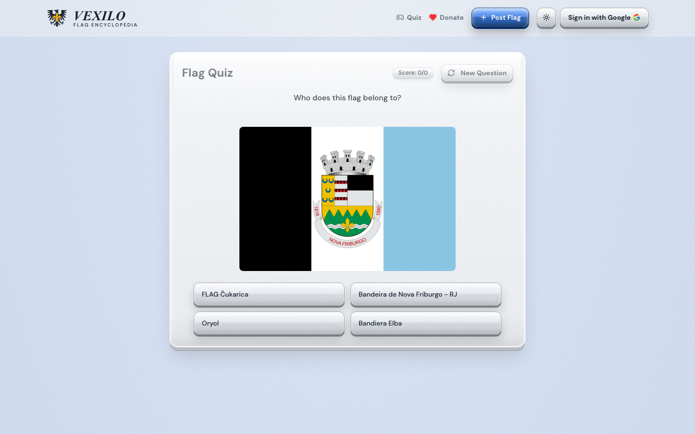

# Vexilo

[Vexilo](https://vexilo.org) is a community-built flag encyclopedia with over 15,000 flags from countries, regions, cities, organizations, history and fiction. You can search and filter flags by tag, read about each one, save favorites, and test yourself with the flag quiz. Signed-in users can post new flags and suggest edits, and they climb the contributor leaderboard as their submissions are approved. There's a new flag of the day every day.

